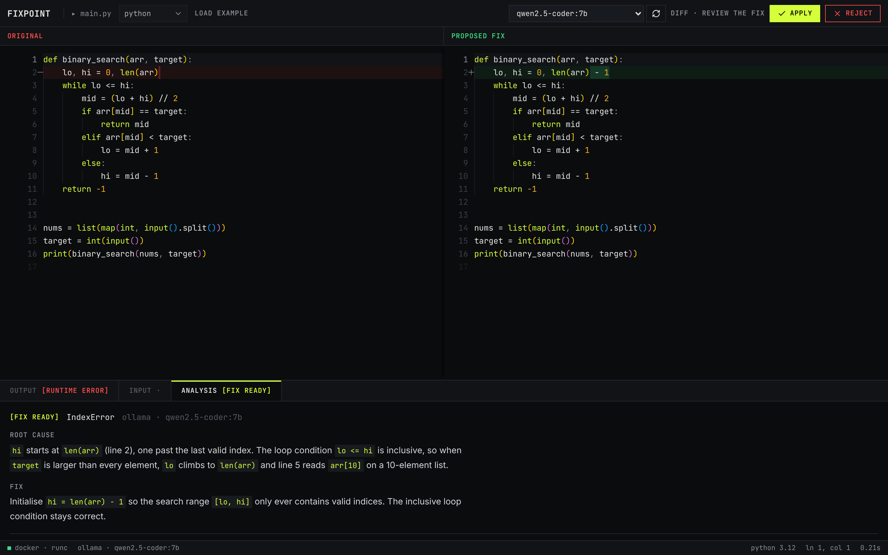

<div align="center">

# Fixpoint

**Fixes you can run.**

A browser IDE with a debugging agent that runs your code in a sandbox, patches the bug, re-runs the patch to prove it works, and only then shows you the diff. Learn mode gives hints instead of answers.


</div>

---


<p align="center"><sub>Code runs with stdin in a locked-down Docker container. stdout and stderr are captured separately.</sub></p>



<p align="center"><sub>Fix runs the code server-side, sends the real output to the model, and shows a side-by-side diff with the root cause.</sub></p>


<p align="center"><sub>C++ is compiled with AddressSanitizer and UBSan, so memory bugs produce a precise report instead of silent garbage.</sub></p>

---

## Why

Pasting an error into a chat assistant gives you a fix that was never run. It may not compile, may hide the symptom, or may delete the line that failed. And when the code runs but prints the wrong answer, there is no error to paste at all.

Fixpoint closes the loop:

```
run → capture failure + runtime state → hypothesise → patch → re-run in sandbox
    → still failing? feed the new failure back and retry (bounded)
    → passing?  generate a regression test that fails on the old code and passes on the new
    → show the diff, labelled VERIFIED
```

A fixed point is where applying a function stops changing the result. Fixpoint patches until the program stops failing.

## Features

| | Feature | Status |
|---|---|---|
| ▶ | Run Python, JavaScript, C++ and Java with stdin in an isolated container | ✅ |
| 🔒 | Hardened sandbox: no network, non-root, read-only code, dropped capabilities, CPU/memory/pids limits, output cap | ✅ |
| 🧭 | Separate compile and run phases: compile errors, runtime errors, timeouts and OOM are reported distinctly | ✅ |
| 🧼 | C++ built with AddressSanitizer + UBSan | ✅ |
| 🔍 | AI diagnosis with root cause and full corrected code, from the real sandbox output | ✅ |
| ⇄ | Monaco editor and side-by-side diff with Apply / Reject; Apply re-runs the code | ✅ |
| 🔌 | Providers: Ollama (local), Groq, OpenRouter, Anthropic; model picker in the UI | ✅ |
| 🔁 | Agent loop: patch → re-run → retry until the code passes | 🚧 Phase 2 |
| ✅ | VERIFIED / UNVERIFIED labels, generated regression test | 🚧 Phase 3 |
| 🧪 | Test cases (input + expected output) to catch "Wrong Answer" logic bugs | 🚧 Phase 3 |
| 🎓 | Learn mode: 4-level hint ladder before the fix is revealed | 🚧 Phase 4 |
| 📊 | Benchmark results on QuixBugs / DebugBench per model | 🚧 Phase 5 |

## Tech stack

| Layer | Tech |
|---|---|
| Frontend | React 19, Vite, Tailwind CSS, Monaco Editor (bundled, works offline), react-markdown |
| Backend | Python, FastAPI, Pydantic, pydantic-settings, httpx |
| Sandbox | Docker (Docker SDK for Python); gVisor (`runsc`) supported via config |
| LLM | Ollama, Groq, OpenRouter (OpenAI-compatible API), Anthropic (tool use for structured output) |
| Tests | pytest (unit + real-Docker integration), ESLint, Ruff |

## Architecture

```
Browser (React + Monaco)
   │  /api/run   /api/debug   /api/health   /api/providers
   ▼
FastAPI
   ├── sandbox/  ──► Docker SDK ──► ephemeral container per run
   │                  no network · uid 65534 · read-only /work · tmpfs /tmp
   │                  cap_drop ALL · no-new-privileges · cpu/mem/pids limits
   ├── agent/    ──► prompt with numbered code + real stdout/stderr
   └── llm/      ──► Ollama | Groq | OpenRouter | Anthropic
```

Full design: [`docs/technical.md`](docs/technical.md).

## Getting started

### Prerequisites

- [Node.js](https://nodejs.org/) 18+
- [Python](https://www.python.org/downloads/) 3.10+
- [Docker Desktop](https://www.docker.com/products/docker-desktop/) (running)
- [Ollama](https://ollama.com/) for local models, or an API key for Groq / OpenRouter / Anthropic

### 1. Clone

```bash
git clone https://github.com/Priyansh10ff/Fixpoint.git
cd Fixpoint
```

### 2. Model and sandbox images

```bash
ollama pull qwen2.5-coder:7b

docker pull python:3.12-slim
docker pull node:20-alpine
docker pull gcc:14
docker pull eclipse-temurin:21-jdk
```

The backend also pulls missing images in the background on startup (`PREPULL_IMAGES=true`), but pulling first avoids a slow first run.

### 3. Backend

```bash
cd backend
python -m venv venv
# macOS / Linux
source venv/bin/activate
# Windows
venv\Scripts\activate

pip install -r requirements.txt
cp .env.example .env        # Windows: copy .env.example .env
uvicorn app.main:app --reload --port 8000
```

API at `http://localhost:8000`, interactive docs at `http://localhost:8000/docs`.

### 4. Frontend

In a second terminal:

```bash
cd frontend
npm install
cp .env.example .env        # optional, defaults to http://localhost:8000
npm run dev
```

Open `http://localhost:5173`. Each language opens with a buggy example: press **Run** (`Ctrl+Enter`), then **Fix** (`Ctrl+Shift+Enter`).

## Configuration

All settings live in `backend/.env` (see [`backend/.env.example`](backend/.env.example)).

| Variable | Default | Purpose |
|---|---|---|
| `DEFAULT_PROVIDER` | `ollama` | `ollama`, `groq`, `openrouter` or `anthropic` |
| `OLLAMA_MODEL` | `qwen2.5-coder:7b` | Default local model |
| `GROQ_API_KEY` / `OPENROUTER_API_KEY` / `ANTHROPIC_API_KEY` | empty | Providers without a key are hidden in the UI |
| `*_MODEL` | empty | Default model per provider (empty = first listed) |
| `RUN_TIMEOUT_S` / `COMPILE_TIMEOUT_S` | `5` / `15` | Time limits |
| `CPU_LIMIT` | `0.5` | CPUs per container |
| `MAX_CONCURRENT_RUNS` | `4` | Parallel containers |
| `CONTAINER_RUNTIME` | empty | Set `runsc` to use gVisor |
| `IMAGE_PYTHON` … `IMAGE_JAVA` | official images | Sandbox images |
| `CORS_ORIGINS` | `http://localhost:5173,…` | Allowed frontend origins |

## API

| Method | Path | Body | Returns |
|---|---|---|---|
| `GET` | `/api/health` | — | Docker status, which images are present, runtime |
| `GET` | `/api/providers` | — | Providers, availability (with reason) and models |
| `POST` | `/api/run` | `{ language, code, stdin? }` | `{ status, exit_code, stdout, stderr, duration_ms, truncated, message, language_hint }` |
| `POST` | `/api/debug` | `{ language, code, stdin?, provider?, model? }` | `{ run, diagnosis: { error_type, root_cause, fix_summary, fixed_code }, analysis, changed, provider, model }` |

`status` is one of `ok`, `runtime_error`, `compile_error`, `timeout`, `oom`, `sandbox_error`. `/api/debug` returns `503` when the sandbox is unavailable and `502` when the model call fails.

## Tests

```bash
cd backend
pip install -r requirements-dev.txt
pytest            # unit tests + Docker integration tests (skipped if Docker or images are missing)
ruff check .

cd ../frontend
npm run lint
npm run build
```

The integration suite runs real containers and checks stdin, stream separation, timeouts, network isolation, non-root and read-only mounts, fork bombs, memory limits, output truncation, C++ compile errors and AddressSanitizer reports.

## Project structure

```
Fixpoint/
├── backend/
│   ├── app/
│   │   ├── main.py            # app factory, CORS, startup image pre-pull
│   │   ├── config.py          # settings from .env
│   │   ├── schemas.py         # request/response models
│   │   ├── api/routes.py      # /api/health, /providers, /run, /debug
│   │   ├── sandbox/           # languages.py (per-language config), runner.py (containers)
│   │   ├── llm/               # base, openai_compat, anthropic, registry
│   │   └── agent/             # prompts.py, debugger.py
│   ├── tests/
│   ├── requirements.txt
│   └── .env.example
├── frontend/
│   └── src/
│       ├── App.jsx            # state, shortcuts, layout
│       ├── components/        # Toolbar, CodeEditor, DiffView, BottomPanel, Terminal, StdinPanel, DebugPanel, StatusBar, ModelPicker
│       ├── hooks/useBackend.js
│       └── lib/               # api client, Monaco setup, languages, storage
├── docs/                      # product.md, technical.md, design.md, assets/
└── README.md
```

## Security

User code is untrusted. Each run gets a fresh container with no network, uid 65534, a read-only mount of the code, a tmpfs `/tmp`, all capabilities dropped, `no-new-privileges`, and CPU, memory and process limits. The container is removed after every run. For a public deployment, use gVisor (`CONTAINER_RUNTIME=runsc`) on a VM that runs nothing else, since the backend holds the Docker socket.

Do not expose the backend publicly before Phase 7: there is no rate limiting or auth yet.

## Roadmap

| Phase | Scope | Status |
|---|---|---|
| 0 | Docs, rename, repo setup | ✅ |
| 1 | Sandbox hardening, Java, stdin, provider layer, Monaco, component split, tests | ✅ |
| 2 | Agent loop with live attempt timeline (SSE) | ⬜ next |
| 3 | Test cases, generated regression test, VERIFIED labels | ⬜ |
| 4 | Learn mode (hint ladder) | ⬜ |
| 5 | Eval harness + published benchmark | ⬜ |
| 6 | Sessions, share links, example gallery | ⬜ |
| 7 | Deploy, rate limits, CI | ⬜ |
| 8 | Launch | ⬜ |

Details per phase: [`docs/product.md`](docs/product.md#8-build-phases).

## Contributing

Issues and pull requests are welcome.

1. Fork the repo and create a branch: `git checkout -b feat/your-change`
2. Run the tests and linters above
3. Open a pull request describing what changed and how you tested it

## License

[MIT](LICENSE) © 2026 Priyansh Dugar
