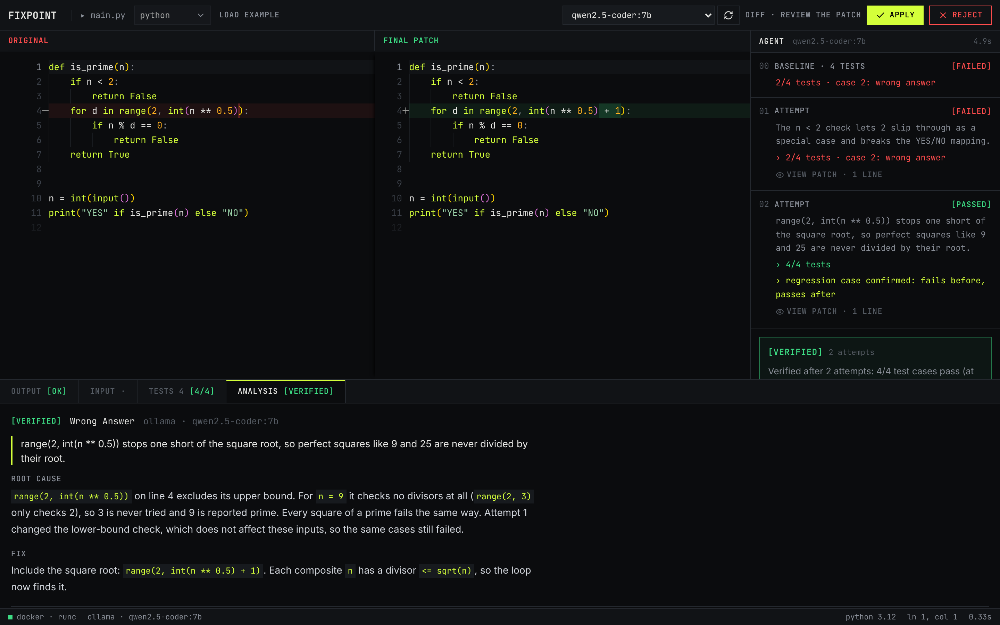
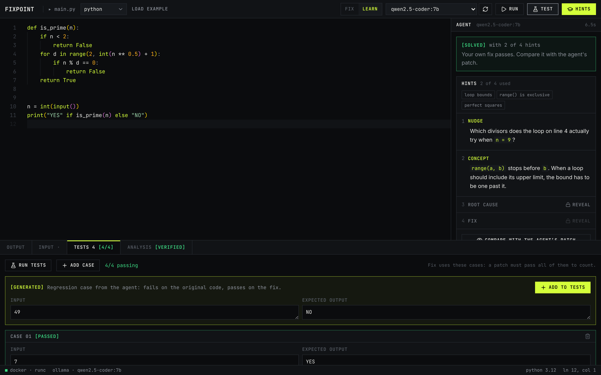
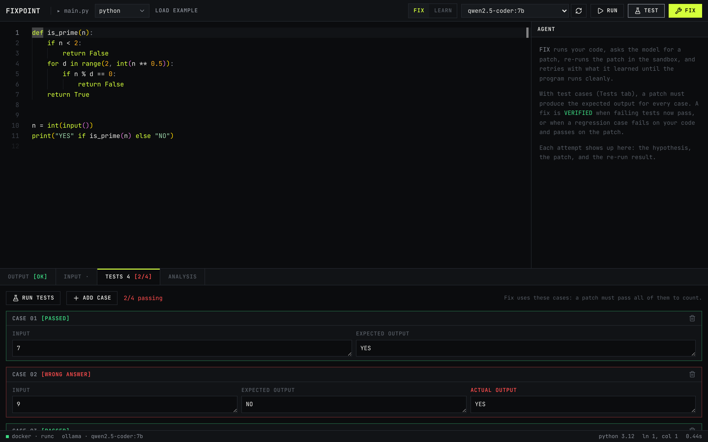
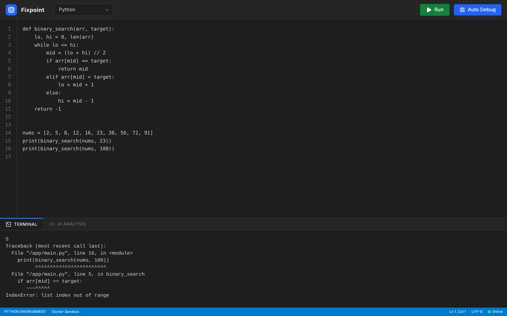
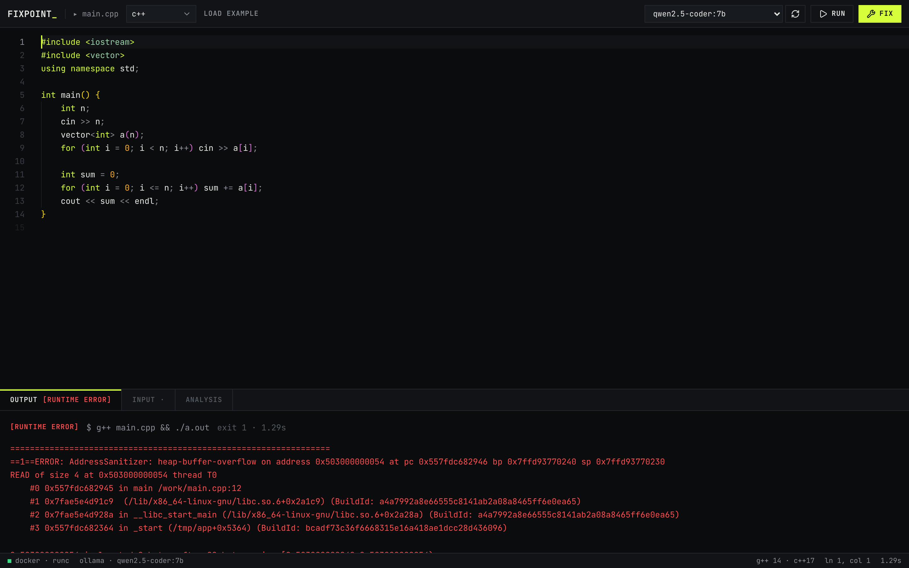

<div align="center">

# Fixpoint

**Fixes you can run.**

A browser IDE with a debugging agent that runs your code in a sandbox, patches the bug, re-runs the patch to prove it works, and only then shows you the diff. Learn mode gives hints instead of answers.


</div>

---



<p align="center"><sub>A primality check that never crashes but answers wrong. The first patch re-runs against the test cases and still fails 2/4. The second passes 4/4, and its generated regression case (49 → NO) fails on the original and passes on the patch: <b>VERIFIED</b>.</sub></p>



<p align="center"><sub>Learn mode. The agent verifies a fix in the background and hides it. The learner opens two hints, fixes the loop bound themselves, and the tests pass: <b>SOLVED with 2 of 4 hints</b>. The agent's patch unlocks only now.</sub></p>



<p align="center"><sub>Test cases are input + expected output, the format used in competitive programming. All cases run in one container with one compile; each case shows its verdict and the actual output.</sub></p>



<p align="center"><sub>Runs happen in a locked-down Docker container. Python failures include the failing line, function and local variables; the line is highlighted in the editor.</sub></p>



<p align="center"><sub>C++ is compiled with AddressSanitizer and UBSan, so memory bugs produce a precise report instead of silent garbage.</sub></p>

---

## Why

Pasting an error into a chat assistant gives you a fix that was never run. It may not compile, may hide the symptom, or may delete the line that failed. And when the code runs but prints the wrong answer, there is no error to paste at all.

Fixpoint closes the loop:

```
run → capture failure + runtime state → hypothesise → patch → re-run in sandbox
    → still failing? feed the new failure back and retry (bounded)
    → passing?  generate a regression test that fails on the old code and passes on the new
    → show the diff, labelled VERIFIED
```

A fixed point is where applying a function stops changing the result. Fixpoint patches until the program stops failing.

## Features

| | Feature | Status |
|---|---|---|
| ▶ | Run Python, JavaScript, C++ and Java with stdin in an isolated container | ✅ |
| 🔒 | Hardened sandbox: no network, non-root, read-only code, dropped capabilities, CPU/memory/pids limits, output cap | ✅ |
| 🧭 | Separate compile and run phases: compile errors, runtime errors, timeouts and OOM are reported distinctly | ✅ |
| 🧼 | C++ built with AddressSanitizer + UBSan | ✅ |
| 🔁 | Agent loop: hypothesis → patch → re-run in sandbox → retry with what failed, streamed live | ✅ |
| 🛡️ | Patch guards: rejects patches that delete logic, silence errors with empty except/catch, or don't parse | ✅ |
| 🔬 | Runtime context: failing line, function and locals (Python); parsed errors for JS, C++, Java | ✅ |
| 🧩 | Multi-bug programs: when a patch moves the error, the loop continues from it | ✅ |
| ⇄ | Monaco editor, side-by-side diff of any attempt, Apply re-runs the code | ✅ |
| 🔌 | Providers: Ollama (local), Groq, OpenRouter, Anthropic; model picker in the UI | ✅ |
| 🧪 | Test cases (input + expected output) catch "Wrong Answer" logic bugs, not only crashes | ✅ |
| ✅ | VERIFIED fixes: failing tests now pass, or a generated regression case fails before and passes after | ✅ |
| 🚫 | Patches that hardcode an expected test output are rejected | ✅ |
| 🎓 | Learn mode: 4 graded hints (nudge → concept → root cause → fix in words), built from the verified patch | ✅ |
| 🔒 | Learn mode hides the patch, hypotheses and analysis until the last hint or until you solve it yourself | ✅ |
| 💬 | Explain any patch: what it changes and why it works | ✅ |
| 📊 | Eval harness: QuixBugs + fixpoint-bench, hidden-test check for false VERIFIEDs, token and latency tracking | ✅ |

## Tech stack

| Layer | Tech |
|---|---|
| Frontend | React 19, Vite, Tailwind CSS, Monaco Editor (bundled, works offline), react-markdown |
| Backend | Python, FastAPI, Pydantic, pydantic-settings, httpx |
| Sandbox | Docker (Docker SDK for Python); gVisor (`runsc`) supported via config |
| LLM | Ollama, Groq, OpenRouter (OpenAI-compatible API), Anthropic (tool use for structured output) |
| Tests | pytest (unit + real-Docker integration), ESLint, Ruff |

## Architecture

```
Browser (React + Monaco)
   │  /api/run   /api/test   /api/fix (SSE)   /api/explain   /api/health   /api/providers
   ▼
FastAPI
   ├── sandbox/  ──► Docker SDK ──► ephemeral container per run
   │                  no network · uid 65534 · read-only /work · tmpfs /tmp
   │                  cap_drop ALL · no-new-privileges · cpu/mem/pids limits
   ├── agent/    ──► loop: diagnose → guard → re-run → retry (history-aware prompts)
   └── llm/      ──► Ollama | Groq | OpenRouter | Anthropic
```

Full design: [`docs/technical.md`](docs/technical.md).

## Getting started

### Prerequisites

- [Node.js](https://nodejs.org/) 18+
- [Python](https://www.python.org/downloads/) 3.10+
- [Docker Desktop](https://www.docker.com/products/docker-desktop/) (running)
- [Ollama](https://ollama.com/) for local models, or an API key for Groq / OpenRouter / Anthropic

### 1. Clone

```bash
git clone https://github.com/Priyansh10ff/Fixpoint.git
cd Fixpoint
```

### 2. Model and sandbox images

```bash
ollama pull qwen2.5-coder:7b

docker pull python:3.12-slim
docker pull node:20-alpine
docker pull gcc:14
docker pull eclipse-temurin:21-jdk
```

The backend also pulls missing images in the background on startup (`PREPULL_IMAGES=true`), but pulling first avoids a slow first run.

### 3. Backend

```bash
cd backend
python -m venv venv
# macOS / Linux
source venv/bin/activate
# Windows
venv\Scripts\activate

pip install -r requirements.txt
cp .env.example .env        # Windows: copy .env.example .env
uvicorn app.main:app --reload --port 8000
```

API at `http://localhost:8000`, interactive docs at `http://localhost:8000/docs`.

### 4. Frontend

In a second terminal:

```bash
cd frontend
npm install
cp .env.example .env        # optional, defaults to http://localhost:8000
npm run dev
```

Open `http://localhost:5173`. Each language opens with a buggy example and a few test cases. Press **Run** (`Ctrl+Enter`), **Test** (`Ctrl+'`), then **Fix** (`Ctrl+Shift+Enter`). `Esc` stops the agent. Switch to **Learn** mode with the toggle or `Ctrl+M` to get hints instead of a patch.

## Configuration

All settings live in `backend/.env` (see [`backend/.env.example`](backend/.env.example)).

| Variable | Default | Purpose |
|---|---|---|
| `DEFAULT_PROVIDER` | `ollama` | `ollama`, `groq`, `openrouter` or `anthropic` |
| `OLLAMA_MODEL` | `qwen2.5-coder:7b` | Default local model |
| `GROQ_API_KEY` / `OPENROUTER_API_KEY` / `ANTHROPIC_API_KEY` | empty | Providers without a key are hidden in the UI |
| `*_MODEL` | empty | Default model per provider (empty = first listed) |
| `MAX_FIX_ATTEMPTS` | `4` | Patch → re-run attempts per Fix |
| `RUN_TIMEOUT_S` / `COMPILE_TIMEOUT_S` | `5` / `15` | Time limits |
| `CPU_LIMIT` | `0.5` | CPUs per container |
| `MAX_CONCURRENT_RUNS` | `4` | Parallel containers |
| `CONTAINER_RUNTIME` | empty | Set `runsc` to use gVisor |
| `IMAGE_PYTHON` … `IMAGE_JAVA` | official images | Sandbox images |
| `CORS_ORIGINS` | `http://localhost:5173,…` | Allowed frontend origins |

## API

| Method | Path | Body | Returns |
|---|---|---|---|
| `GET` | `/api/health` | — | Docker status, which images are present, runtime |
| `GET` | `/api/providers` | — | Providers, availability (with reason) and models |
| `POST` | `/api/run` | `{ language, code, stdin? }` | `{ status, exit_code, stdout, stderr, duration_ms, truncated, message, language_hint }` |
| `POST` | `/api/test` | `{ language, code, tests: [{ input, expected }] }` | `{ status, passed, total, results: [{ verdict, actual, expected, context }] }` |
| `POST` | `/api/fix` | `{ language, code, stdin?, tests?, mode?: fix \| learn, provider?, model?, max_attempts? }` | Server-Sent Events stream (below) |
| `POST` | `/api/explain` | `{ language, original, patched, provider?, model? }` | `{ explanation: { summary, why, concepts }, diff }` |
| `POST` | `/api/debug` | `{ language, code, stdin?, provider?, model? }` | Single-pass diagnosis, no re-run (kept for scripts) |

`status` is one of `ok`, `runtime_error`, `compile_error`, `timeout`, `oom`, `sandbox_error`. Failing runs include `context: { error_type, message, line, function, locals }`.

Test verdicts: `passed`, `wrong_answer`, `runtime_error`, `compile_error`, `timeout`, `oom`. Outputs are compared ignoring trailing spaces and trailing blank lines.

`/api/fix` streams the agent loop. With `tests`, a patch must pass every case; without, it must run cleanly on `stdin`.

```
event: start          {provider, model, max_attempts, mode: tests | run, test_count}
event: baseline       {run, tests}
event: attempt_start  {n}
event: diagnosis      {n, hypothesis, error_type, root_cause, fix_summary, repro_case}
event: guard_reject   {n, reason}
event: patch          {n, code, diff, changed_lines}
event: verify         {n, run, tests, outcome: passed | failed | progress}
event: repro          {n, case, fails_original, passes_patched, accepted, reason}
event: hints          {status: ok | error | unavailable, based_on, ladder: {concepts, nudge, concept, root_cause, fix_summary}}   # learn mode
event: done           {status, message, final_code, diff, diagnosis, run, tests, attempts, repro_case}
```

`done.status`: `verified` (evidence the bug is fixed), `fixed` (runs cleanly, output unchecked), `partial`, `unresolved`, `no_bug`, `unverified` (suggestion for a program that already ran), `error`.

Try it from a terminal:

```bash
curl -N -X POST http://localhost:8000/api/fix -H "Content-Type: application/json" \
  -d '{"language":"python","code":"a,b=map(int,input().split())\nprint(a-b)\n","tests":[{"input":"2 3","expected":"5"}]}'
```

## Benchmark

Fixpoint is evaluated headless on **QuixBugs** (31 classic algorithms with one-line bugs, Python) and **fixpoint-bench** (13 CP-style programs with realistic bugs across Python, JavaScript, C++ and Java). The agent only sees a few test cases per task; the rest are held out to check whether a VERIFIED fix is actually correct.

<!-- BENCHMARK:START -->
| Model | Dataset | Tasks | Verified | Correct on hidden tests | False-verified | Attempts to verify | p50 / p95 latency | Tokens / task |
|---|---|---:|---:|---:|---:|---:|---:|---:|
| *first model run pending* | | | | | | | | |
<!-- BENCHMARK:END -->

The harness is checked with two baselines that use no model: `oracle` (returns the known fix) scores 100% verified and 100% correct on hidden tests across all 42 runnable tasks, and `echo` (returns the bug unchanged) scores 0%.

Run it (from `backend/`, Docker running, images pulled):

```bash
python -m evals.run --dataset all --baseline oracle                    # harness self-check, no tokens
python -m evals.run --dataset all --provider anthropic --model <model-id> --update-readme
python -m evals.run --dataset bench --provider ollama --model qwen2.5-coder:7b --update-readme
```

Each run writes `backend/evals/results/<time>-<dataset>-<model>.json` and regenerates [`backend/evals/results/RESULTS.md`](backend/evals/results/RESULTS.md). Method and metric definitions: [`docs/technical.md`](docs/technical.md#9-evals-harness-implemented-in-phase-5).

## Tests

```bash
cd backend
pip install -r requirements-dev.txt
pytest            # unit tests + Docker integration tests (skipped if Docker or images are missing)
ruff check .

cd ../frontend
npm run lint
npm run build
```

Unit tests cover the agent loop with a scripted model and sandbox (retry with history, guard rejection, multi-bug progress, wrong-answer fixes, regression-case validation, verdicts), patch guards, error-context parsing, the SSE endpoint and all providers. The integration suite runs real containers and checks stdin, stream separation, timeouts, network isolation, non-root and read-only mounts, fork bombs, memory limits, output truncation, the Python locals harness, multi-case test runs (verdicts, per-case timeout, compile once), C++ compile errors and AddressSanitizer reports.

## Project structure

```
Fixpoint/
├── backend/
│   ├── app/
│   │   ├── main.py            # app factory, CORS, startup image pre-pull
│   │   ├── config.py          # settings from .env
│   │   ├── schemas.py         # request/response models
│   │   ├── api/routes.py      # /api/health, /providers, /run, /test, /debug, /explain, /fix (SSE)
│   │   ├── sandbox/           # runner.py, languages.py, context.py, harness/
│   │   ├── llm/               # base, openai_compat, anthropic, registry
│   │   └── agent/             # loop.py, learn.py, guards.py, prompts.py, debugger.py
│   ├── evals/             # benchmark harness: datasets, runner, metrics, results/
│   ├── tests/
│   ├── requirements.txt
│   └── .env.example
├── frontend/
│   └── src/
│       ├── App.jsx            # state, shortcuts, layout
│       ├── components/        # Toolbar, CodeEditor, DiffView, AgentPanel, HintLadder, TestsPanel, BottomPanel, Terminal, StdinPanel, DebugPanel, StatusBar, ModelPicker
│       ├── hooks/useBackend.js
│       └── lib/               # api + SSE client, fix session reducer, Monaco setup, languages, storage
├── docs/                      # product.md, technical.md, design.md, assets/
└── README.md
```

## Security

User code is untrusted. Each run gets a fresh container with no network, uid 65534, a read-only mount of the code, a tmpfs `/tmp`, all capabilities dropped, `no-new-privileges`, and CPU, memory and process limits. The container is removed after every run. For a public deployment, use gVisor (`CONTAINER_RUNTIME=runsc`) on a VM that runs nothing else, since the backend holds the Docker socket.

Do not expose the backend publicly before Phase 7: there is no rate limiting or auth yet.

## Roadmap

| Phase | Scope | Status |
|---|---|---|
| 0 | Docs, rename, repo setup | ✅ |
| 1 | Sandbox hardening, Java, stdin, provider layer, Monaco, component split, tests | ✅ |
| 2 | Agent loop with live attempt timeline (SSE), runtime context, patch guards | ✅ |
| 3 | Test cases, generated regression test, VERIFIED labels | ✅ |
| 4 | Learn mode (hint ladder), explain patch | ✅ |
| 5 | Eval harness + published benchmark | 🟡 harness done, results pending |
| 6 | Sessions, share links, example gallery | ⬜ |
| 7 | Deploy, rate limits, CI | ⬜ |
| 8 | Launch | ⬜ |

Details per phase: [`docs/product.md`](docs/product.md#8-build-phases).

## Contributing

Issues and pull requests are welcome.

1. Fork the repo and create a branch: `git checkout -b feat/your-change`
2. Run the tests and linters above
3. Open a pull request describing what changed and how you tested it

## License

[MIT](LICENSE) © 2026 Priyansh Dugar
